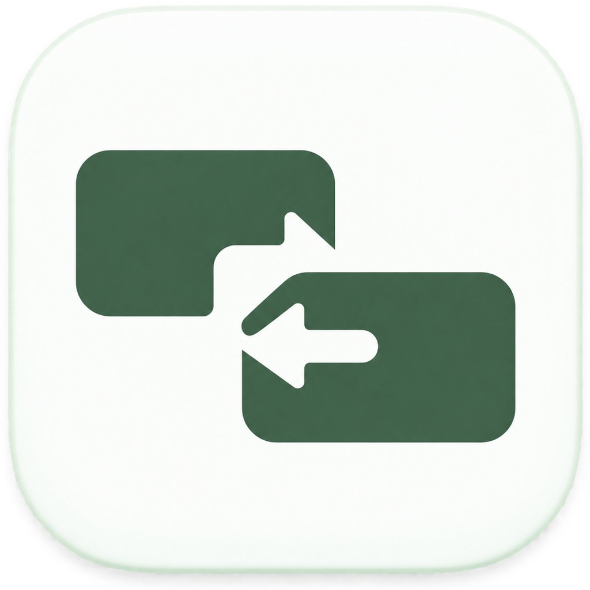

# Qoder Switch

**1.8.0 本地模型网关**：参考 WorkBuddy API 桌面布局，提供 Claude Messages、Codex Responses 和 Chat Completions 接口，支持账号池、模型目录、请求诊断与实际用量。macOS 使用本机 Qoder 原生签名链路。[接入与兼容说明](docs/GATEWAY.md)。

Qoder **国内版 / 国际版** 多账号切换与每日积分自动领取桌面 App（Tauri 2 + Rust），并提供积分统计与 Token 用量监控。

<p align="center">
  
</p>

多账号共享登录态，一键切换 Qoder 登录账号，切换前自动备份、切换后自动重启客户端。支持每日 100 Credits 自动领取：应用运行时内置调度器检查，不开应用时可由系统定时任务代领。积分统计与 Token 统计沿用 wb-switch 同款布局，支持多语言（中文 / English）、时区切换与浅色 / 深色主题。

## 快速开始

前往 [GitHub Releases](https://github.com/AI-Good-Tool/Qoder-Switch/releases/latest) 下载对应平台的安装包：

| 平台 | 安装包 | 安装方式 |
| --- | --- | --- |
| macOS Apple Silicon（M 系列，arm64） | `Qoder.Switch_<版本>_aarch64.dmg` | 打开 DMG，将 `Qoder Switch.app` 拖入「应用程序」 |
| macOS Intel（x86_64） | `Qoder.Switch_<版本>_x64.dmg` | 打开 DMG，将 `Qoder Switch.app` 拖入「应用程序」 |
| Windows x64 | `Qoder.Switch_<版本>_x64-setup.exe` | 运行安装程序并按提示完成安装 |

macOS 首次启动若提示无法验证开发者，先在 Finder 中按住 Control 点击应用并选择「打开」，或前往「系统设置 → 隐私与安全性」选择「仍要打开」。仅当安装包来自上述官方 Releases、且系统仍提示「已损坏」时，再执行：

```bash
xattr -rd com.apple.quarantine "/Applications/Qoder Switch.app"
```

首次运行会弹钥匙串授权框（读取 Qoder 客户端登录态的加密密钥），点「**始终允许**」一次即可。

## 功能

| 模块 | 说明 |
| --- | --- |
| 账号管理 | 一键采集当前登录账号（自动从客户端解密登录态）、备注、删除、导入 / 导出 |
| 添加账号 | 不走客户端也能加号 —— 复刻 Qoder 官方 OAuth 设备流（PKCE S256），国内版 / 国际版独立入口，浏览器登录后凭证自动入库 |
| 账号切换 | 一键切换：自动退出 Qoder → 写回登录态 → 重启应用，切换前自动备份 |
| 账号刷新 | 手动或临期自动用 refreshToken 换新登录凭证并回写客户端；卡片实时显示有效期徽标 |
| 会话管理 | 列出本地会话，支持复制副本（自动建立关联组）、关联组同步、删除（先备份） |
| 积分统计 | 全部 / 国内版 / 国际版视图；剩余积分、今日 / 近 7 天 / 本月消耗指标；账号消耗构成、官方积分消耗柱状图、积分明细；时间范围筛选（快捷项 + 自定义区间） |
| Token 统计 | 基于本地会话估算的 Token 用量：每日趋势、输入 / 输出构成、按项目 / 按模型分布、逐条请求明细；整页统一时间筛选 |
| 每日自动领取 | 「每天 100 Credits」全自动领取，接口幂等不重复发币；应用内每 10 分钟检查，不开应用可注册系统定时任务 |
| 多语言 / 时区 | 中文 / English（非中文默认英文）；时区可自定义，所有时间展示与统计口径跟随所选时区（自动处理夏令时） |
| 数据目录 | 全部数据存于 `~/.qoder-switch/`（账号库、备份、领取日志、偏好设置） |

> 说明：Qoder 不公开逐请求真实 token 数（本地会话中 usage 恒为 0，官方 API 也无明细端点），Token 统计页采用「本地会话请求观测（main.sqlite assistant 消息）+ 官方积分消耗（heatmap）」合成口径。

## 使用

1. **安装后打开**，在 Qoder 客户端里登录账号，点「采集当前账号」入库；换号登录再采集，即可多账号一键切换
2. **添加账号**：账号页 →「添加账号」→ 选择国内版 / 国际版，浏览器完成登录后凭证自动入库
3. **切换账号**：账号卡片 →「切换」；「备注」可给账号添加备注名
4. **查看积分与统计**：侧栏进入「积分统计」「Token 统计」查看用量明细，支持快捷时间筛选与自定义区间
5. **每日自动领取**：应用保持运行即可自动领取；不开应用时执行 `bash install_auto_claim.sh` 注册系统定时任务（每天 10:05 / 22:05）

## 命令行

```
qoder-switch --claim                # 立即对所有账号执行一次领取（打印结果后退出）
qoder-switch --dump-state           # 打印当前状态 JSON（调试用）
qoder-switch --sessions <cn|intl>   # 打印会话列表（调试用）
qoder-switch --cstats               # 打印积分统计（调试用）
qoder-switch --tstats <cn|intl>     # 打印 Token/请求观测统计（调试用）
```

## 技术原理

- **登录态**：`~/Library/Application Support/com.qoder[cn].app.stable/auth.v1.dat`
  （Electron safeStorage：Keychain 密钥 + PBKDF2-HMAC-SHA1(saltysalt,1003) + AES-128-CBC）
- **积分接口**：`GET/POST openapi.qoder.com.cn / openapi.qoder.sh` 的 `/sash/api/v1/me/campaigns[/{id}/claim]`
- **Token 刷新**：`POST /api/v1/deviceToken/refresh`
- **配额**：`GET /sash/api/v2/me/usage`（userQuota + addOnQuota）
- **添加账号**（OAuth 设备流）：`{auth_base}/users/sign-in?biz_variant=qoder&...` → 轮询 `GET /api/v1/deviceToken/poll` → `GET /api/v1/userinfo`；auth_base = `qoder.cn`（国内）/ `qoder.com`（国际）
- **会话**：索引来自 `main.sqlite` 的 `chat_sessions` 表；正文为 `~/.qoder[-cn]/projects/<项目>/<sessionId>.jsonl`；复制副本按行重写 sessionId → 新 UUID 并同步边车目录，关联组存 `~/.qoder-switch/session-links.json`
- **设备标识**：`~/.qoder[-cn]/umid-cache.json` + `auth.machine-id` + umid/runtime-info

## 构建

```bash
cd qoder-switch-app
npx @tauri-apps/cli@2 build
# macOS 产出：src-tauri/target/release/bundle/macos/Qoder Switch.app
```

推送 `v*` 标签（或手动触发 Actions → Release Build）会自动构建 macOS（arm64 / x86_64）与 Windows（x64）安装包并发布到 GitHub Releases，见 `.github/workflows/release.yml`。
